# Freshness-ai

Freshness-ai tells you whether a fruit is **fresh or rotten** from a single photo.

## Video demo

YouTube: **[Watch the demo](https://youtu.be/AhtC3tD3Sls)**

## URLs

| | |
|---|---|
| Web app | https://freshness.bodemurairi.me |
| API | https://api.freshness.bodemurairi.me |
| Documentation | https://api.freshness.bodemurairi.me/docs |

## Project description

Freshness-ai is a 16-class image classifier: 8 fruits (apple, banana, grape, guava, jujube, orange, pomegranate, strawberry), each either fresh or rotten. The model is a MobileNetV2 fine-tuned on 224×224 photos (see [notebook/freshness_ai.ipynb](notebook/freshness_ai.ipynb)).

The application has four pages:

- **Predict:** upload or take a photo and get the fruit, its condition, the confidence and the three most likely classes. Answers below 75% confidence are marked as uncertain. A Grad-CAM heatmap shows which parts of the photo the model relied on.
- **Models:** every model version with its training, validation and test metrics, training curves and confusion matrix, and a button to choose the model used for predictions.
- **Insights:** dataset class distribution, visual features of fresh and rotten fruit (colour, dark spots, brown areas), and the model's performance.
- **Retrain:** signed-in users upload labelled photos (saved in MongoDB and Cloudflare R2), then retrain the current model on them and follow the progress live. Each new model keeps a link to the model it was trained from.

## Tech stack

### Model development

| Tool | Used for |
|---|---|
| Python 3.13, Jupyter | Notebook for the full pipeline ([notebook/freshness_ai.ipynb](notebook/freshness_ai.ipynb)) |
| Hugging Face Hub, PyArrow | Downloading the fruit datasets |
| Pillow, pillow-heif | Loading and resizing images (JPG, PNG, WEBP, HEIC) |
| TensorFlow 2.21, Keras 3 | MobileNetV2 (ImageNet weights) fine-tuned for 16 classes, data augmentation, early stopping |
| TensorBoard | Training logs, epoch by epoch |
| scikit-learn | Precision, recall, F1, ROC-AUC, confusion matrix |
| NumPy, pandas, Matplotlib | Data analysis and figures |
| OpenCV | Grad-CAM heatmaps |

### Backend development

| Tool | Used for |
|---|---|
| FastAPI, Pydantic | REST API: prediction, Grad-CAM, upload, retraining, models, insights, authentication |
| MongoDB Atlas (PyMongo) | Cloud database: users, uploads, predictions, retraining runs, model versions and metrics |
| Cloudflare R2 (boto3) | Image storage: uploaded training photos and prediction photos, each with a public link saved in MongoDB |
| PyJWT, pwdlib (Argon2) | Sign-in tokens and password hashing |
| Gmail SMTP | Emails with password reset codes |
| React 19, React Router, Vite | Web interface |
| Locust | Flood request simulation |

### Deployment

| Tool | Used for |
|---|---|
| Docker, Docker Compose | Three containers: backend, frontend and Caddy |
| Caddy | Reverse proxy with automatic HTTPS (Let's Encrypt) |
| nginx | Serves the built React app inside the frontend container |
| AWS EC2 | `c7i-flex.large` instance (2 vCPUs, 4 GB RAM), Ubuntu 24.04 |
| Namecheap DNS | `freshness.bodemurairi.me` and `api.freshness.bodemurairi.me` |

## Project structure

```text
freshness-ai/
├── api/                        FastAPI backend
│   ├── main.py                 app start: database connection, CORS, routes
│   ├── router.py               registers all the routes
│   ├── config/                 settings read from .env
│   ├── cors_handler/           allowed frontend addresses (CORS)
│   ├── database/               MongoDB Atlas connection and indexes
│   ├── routers/                endpoints: /predict, /retrain, /insights, /auth
│   ├── schemas/                request and response formats (Pydantic)
│   └── services/               logic behind the endpoints: image checks, uploads to R2,
│                               retraining jobs, model metrics, users, emails, insights
├── src/                        machine learning code, used by the API and the notebook
│   ├── preprocessing.py        image loading and resizing to 224×224
│   ├── model.py                loading, listing and selecting model versions
│   ├── prediction.py           predictions, confidence and decision threshold
│   ├── gradcam.py              Grad-CAM heatmaps
│   ├── retraining.py           retraining on uploaded photos and evaluation on the test set
│   └── target_class.py         the 16 class names
├── notebook/
│   └── freshness_ai.ipynb      data analysis, training, evaluation and Grad-CAM of the original model
├── models/
│   └── model/                  the deployed model (freshness-ai.keras)
├── data/
│   ├── train/                  2,080 training images, one folder per class
│   ├── validation/             480 validation images
│   ├── test/                   640 test images
│   ├── samples/                labelled photos (not from the dataset) to try retraining
│   ├── sample/                 a few photos to try predictions
│   ├── uploads/                photos uploaded for retraining (one folder per class)
│   └── dataset_features.json   colour, dark spots and brown areas per class (insights page)
├── scripts/                    one-off tools: download and resize the dataset, build the samples,
│                               back up the data to R2, export notebook figures, save training history
├── freshness_frontend/         React web app (Vite)
│   ├── src/pages/              Predict, Models, Insights, Retrain and account pages
│   ├── src/components/         layout, charts, training curves, notebook figures
│   ├── src/api/                calls to the API
│   ├── src/auth/               sign-in state
│   ├── src/data/               fruit classes and sample photos
│   ├── public/                 fruit pictures, sample photos and notebook figures
│   ├── Dockerfile              builds the app and serves it with nginx
│   └── nginx.conf              nginx settings
├── locust/
│   ├── locustfile.py           flood request simulation
│   ├── run_load_test.sh        runs it for any number of users
│   └── results/                CSV results of the test runs
├── Dockerfile                  backend image
├── docker-compose.yml          backend, frontend and Caddy containers
├── Caddyfile                   HTTPS and routing for the two domains
├── requirements.txt            all Python packages (notebook, API, load test)
├── requirements-api.txt        Python packages for the backend image only
└── .env.example                every setting the backend needs, with explanations
```

## Model performance

Overall performance of the deployed model, `freshness-ai.keras`.

| Metric | Training (2,080 images) | Validation (480 images) | Test (640 images) |
|---|---|---|---|
| Accuracy | 99.33% | 96.25% | 98.59% |
| Precision | 99.42% | 97.45% | 98.61% |
| Recall | 98.99% | 95.63% | 98.59% |
| F1 score | 99.32% | 96.23% | 98.58% |
| Loss | 0.0448 | 0.1123 | – |
| ROC-AUC | – | – | 99.97% |

Training and validation values come from epoch 25, the epoch kept by early stopping (out of 30). Training values were measured with data augmentation on. On the test set, 9 of 640 photos were misclassified.

## Database (MongoDB Atlas)

All application data is stored in a MongoDB Atlas cluster, in the `freshness_ai` database. Images are stored in Cloudflare R2, and MongoDB keeps their metadata and public link.

| Collection | One document per | Indexes |
|---|---|---|
| `users` | registered user | unique email, unique username |
| `uploads` | uploaded training photo, with the user who uploaded it | label |
| `retraining_runs` | retraining run, with its live progress | only one run can be `running` at a time |
| `models` | model version, with its training history and test metrics | – |
| `predictions` | prediction made in the app | created_at |
| `password_codes` | password reset code (stored hashed) | deleted automatically when expired |

### Screenshots of the database

The `freshness_ai` database on the MongoDB Atlas cluster `freshnes-ai`, opened with MongoDB Compass. The six collections are listed on the left.

**`uploads`**: each uploaded photo with its label, its file in Cloudflare R2 (`storage_url`) and the user who uploaded it (`uploaded_by`, blurred here).

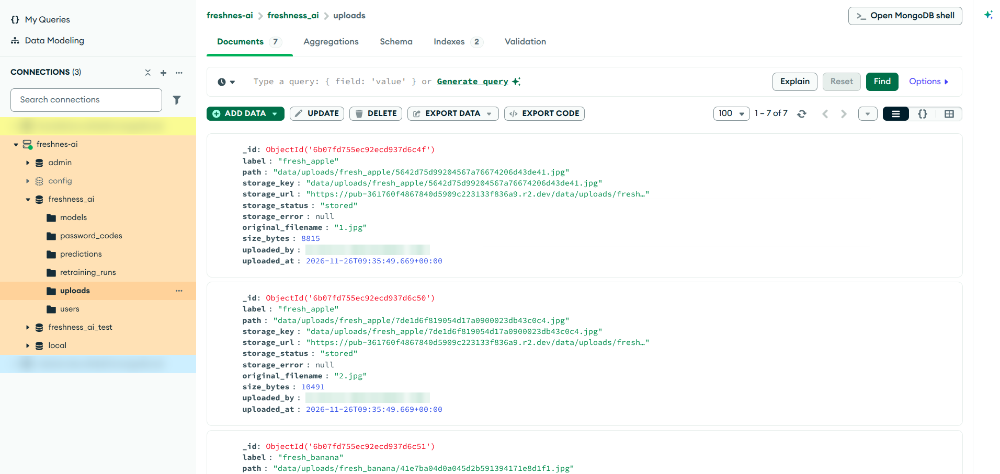

**`retraining_runs`**: a finished retraining run with its result: new model, number of uploads, training history, and test results before and after.

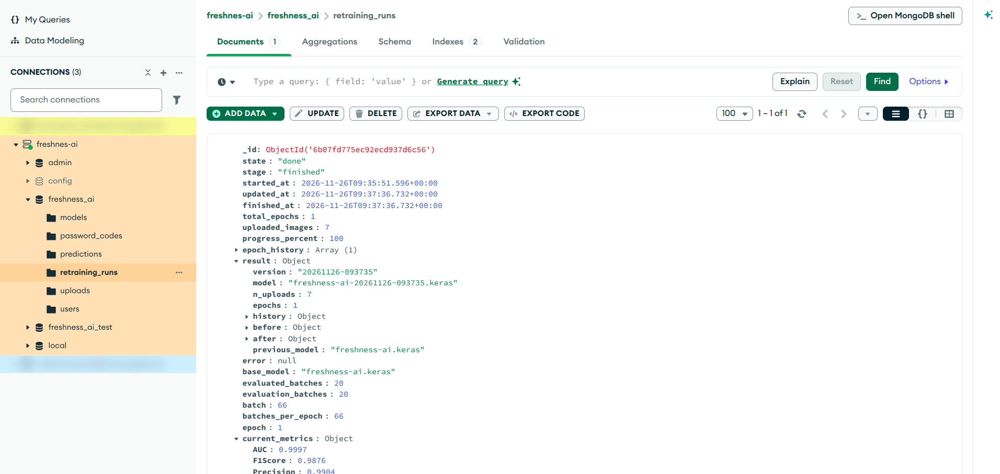

**`models`**: the original model (trained in the notebook) and the retrained model, linked to its parent model and its retraining run.

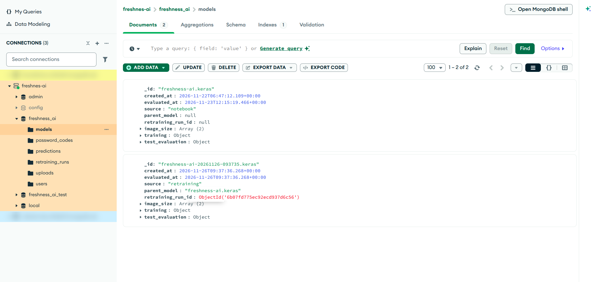

**Training history of the retrained model**, saved per epoch with the test results.

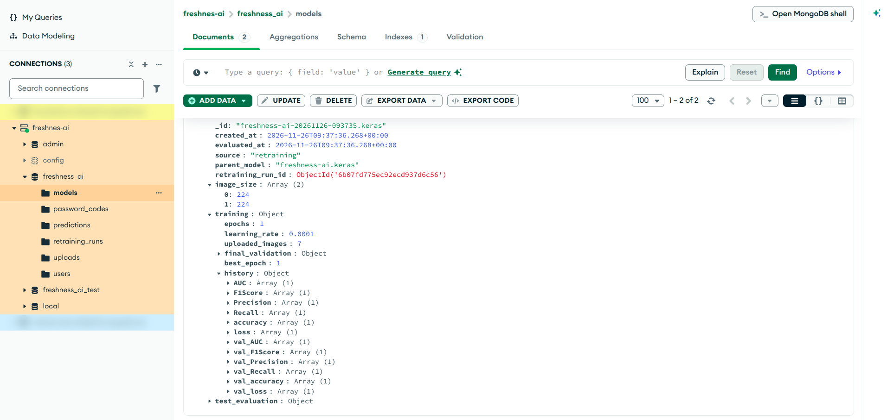

<details>
<summary>More screenshots: the other uploads, the run's progress and metrics, the original model, predictions and users</summary>

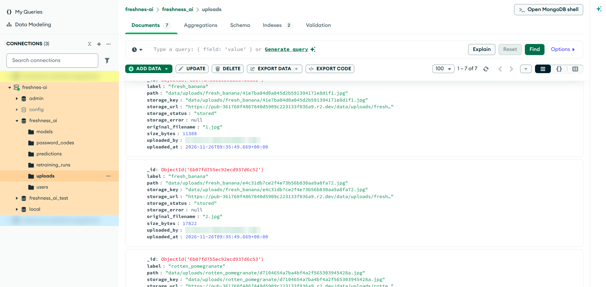

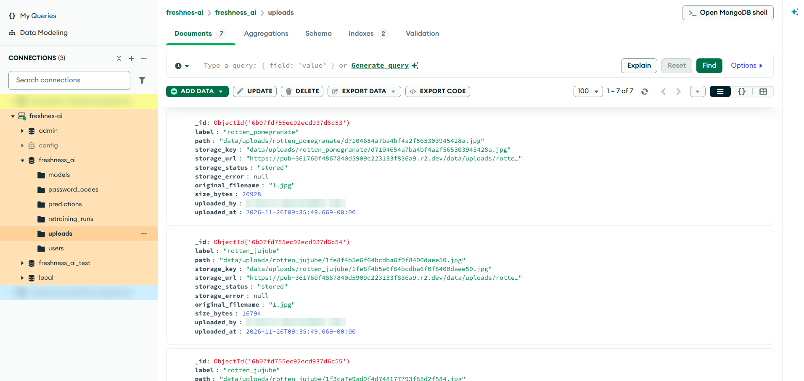

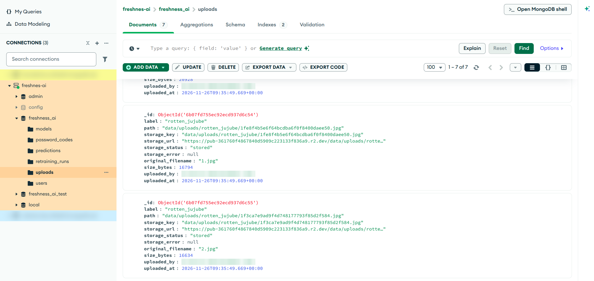

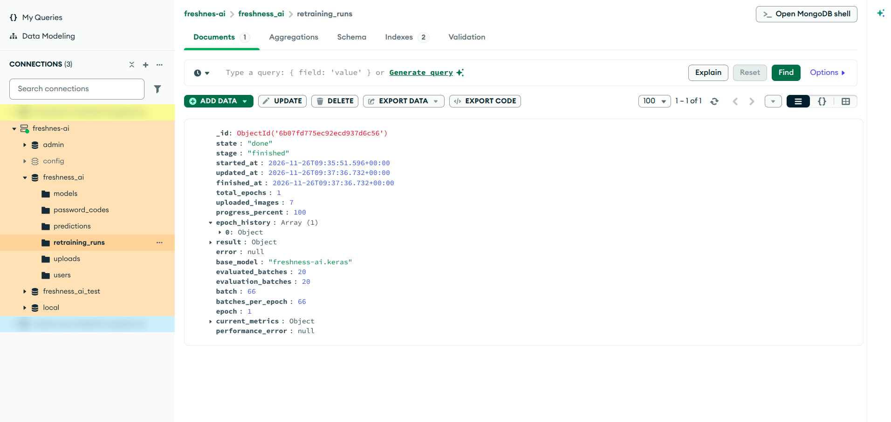

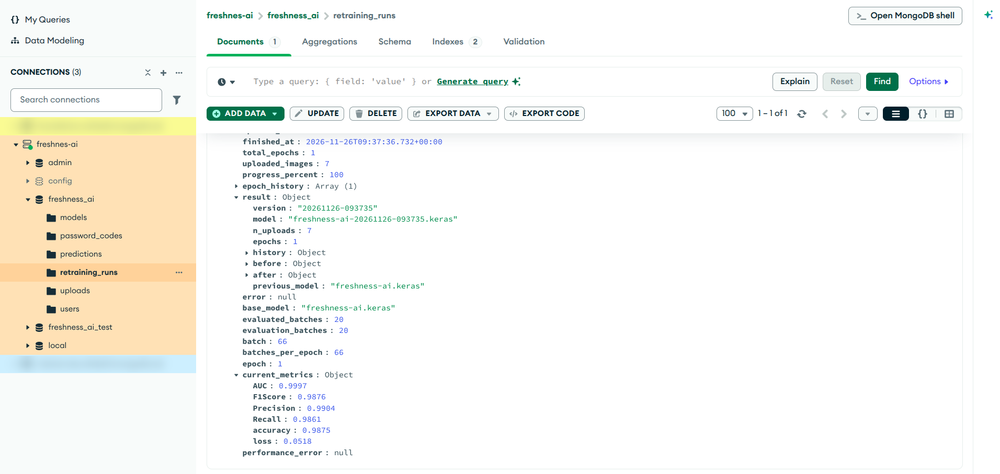

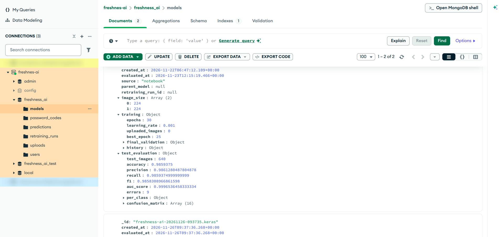

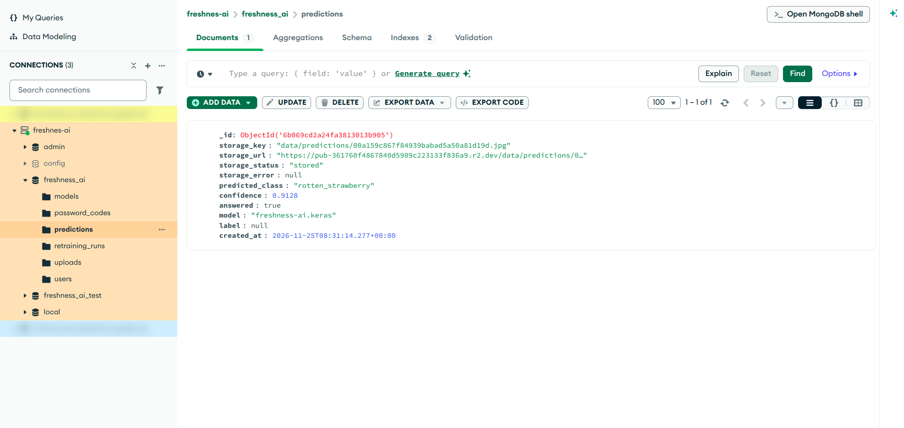

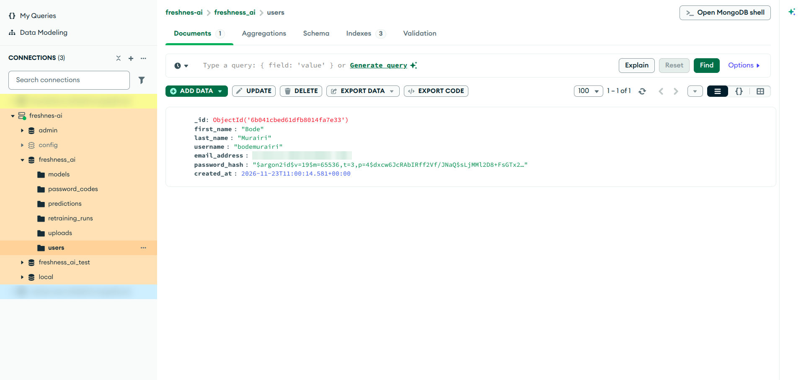

</details>

### Where the data is saved in the code

**Uploaded files (photo in Cloudflare R2, metadata in the `uploads` collection)**

| Step | Code |
|---|---|
| `POST /retrain/model` receives the photos and their labels (signed-in users only) | [api/routers/retraining.py](api/routers/retraining.py#L41) |
| Each photo is saved and its metadata (label, path, size, original name, `uploaded_by`, date) is inserted in MongoDB | [api/services/save_image.py](api/services/save_image.py#L57) |
| After the response, each photo is sent to R2 and its public link (`storage_url`) is saved in the same document | [api/services/save_image.py](api/services/save_image.py#L81), [api/services/file_storage.py](api/services/file_storage.py#L37) |

**Training history**

| What is saved | Collection | Code |
|---|---|---|
| A retraining run and its live progress: stage, epoch, metrics of every epoch | `retraining_runs` | [api/services/retrain_status.py](api/services/retrain_status.py#L36), updated by the Keras callback in [src/retraining.py](src/retraining.py#L43) |
| A retrained model: full training history, test metrics, parent model | `models` | [api/services/model_performance.py](api/services/model_performance.py#L42), called by [api/services/retrain_job.py](api/services/retrain_job.py#L22) |
| The original model: 30-epoch history from the notebook's TensorBoard logs | `models` | [scripts/save_training_history.py](scripts/save_training_history.py) |

**Predictions** (photo in R2, result in the `predictions` collection): [api/services/prediction_records.py](api/services/prediction_records.py#L21).

### Example documents

Documents are shown in MongoDB Extended JSON, as in the Atlas Data Explorer (`$oid` is an ObjectId, `$date` a date). The `uploads`, `predictions`, `retraining_runs` and `models` documents are real, copied from the database (the same ones as in the screenshots); the uploader's email address is hidden. The `users` and `password_codes` documents show the exact structure the application saves, with example values.

**`uploads`**: one photo uploaded for retraining, with the user who uploaded it and its link in Cloudflare R2.

```json
{
  "_id": {"$oid": "6b07fd755ec92ecd937d6c4f"},
  "label": "fresh_apple",
  "path": "data/uploads/fresh_apple/5642d75d99204567a76674206d43de41.jpg",
  "storage_key": "data/uploads/fresh_apple/5642d75d99204567a76674206d43de41.jpg",
  "storage_url": "https://pub-361760f4867840d5909c223133f836a9.r2.dev/data/uploads/fresh_apple/5642d75d99204567a76674206d43de41.jpg",
  "storage_status": "stored",
  "storage_error": null,
  "original_filename": "1.jpg",
  "size_bytes": 8815,
  "uploaded_by": "b.m*******@alustudent.com",
  "uploaded_at": {"$date": "2026-11-26T09:35:49.669Z"}
}
```

**`users`**: one registered user. Only an Argon2 hash of the password is stored.

```json
{
  "_id": {"$oid": "6b05a969e2159fd97bfd3085"},
  "first_name": "Amina",
  "last_name": "Uwase",
  "username": "aminauwase",
  "email_address": "amina.uwase@example.com",
  "password_hash": "$argon2id$v=19$m=65536,t=3,p=4$Ds4wGO6byd9eMFI2dtLi2w$oNW0E5mOvaE+BofamXY19Hl7RWPHoqwNIjjZfLD4D2M",
  "created_at": {"$date": "2026-11-24T15:12:41.207Z"}
}
```

**`password_codes`**: a password reset code, stored as a hash. MongoDB deletes it automatically at `expires_at`.

```json
{
  "_id": "amina.uwase@example.com",
  "code_hash": "5008ecefda62bd8826d196288a5ac7b301d84411e209d01b75c1384150706bc0",
  "attempts": 1,
  "created_at": {"$date": "2026-11-25T07:58:03.512Z"},
  "expires_at": {"$date": "2026-11-25T08:08:03.512Z"}
}
```

**`predictions`**: one prediction from the Predict page. The photo is kept without a label, so it can be labelled and used for training later.

```json
{
  "_id": {"$oid": "6b069cd2a24fa3813013b905"},
  "storage_key": "data/predictions/00a159c867f84939babad5a50a81d19d.jpg",
  "storage_url": "https://pub-361760f4867840d5909c223133f836a9.r2.dev/data/predictions/00a159c867f84939babad5a50a81d19d.jpg",
  "storage_status": "stored",
  "storage_error": null,
  "predicted_class": "rotten_strawberry",
  "confidence": 0.9128,
  "answered": true,
  "model": "freshness-ai.keras",
  "label": null,
  "created_at": {"$date": "2026-11-25T08:31:14.277Z"}
}
```

**`retraining_runs`**: the retraining run from the demo (7 uploaded photos, 1 epoch). The Retrain page reads this document every few seconds to show the live progress. `before` and `after` are the test-set results of the old and the new model.

<details>
<summary>Show the full <code>retraining_runs</code> document</summary>

```json
{
  "_id": {"$oid": "6b07fd775ec92ecd937d6c56"},
  "state": "done",
  "stage": "finished",
  "started_at": {"$date": "2026-11-26T09:35:51.596Z"},
  "updated_at": {"$date": "2026-11-26T09:37:36.732Z"},
  "finished_at": {"$date": "2026-11-26T09:37:36.732Z"},
  "total_epochs": 1,
  "uploaded_images": 7,
  "progress_percent": 100,
  "epoch_history": [
    {
      "epoch": 1,
      "AUC": 0.9997,
      "F1Score": 0.9876,
      "Precision": 0.9904,
      "Recall": 0.9861,
      "accuracy": 0.9875,
      "loss": 0.0518,
      "val_AUC": 0.9995,
      "val_F1Score": 0.9561,
      "val_Precision": 0.9662,
      "val_Recall": 0.9521,
      "val_accuracy": 0.9563,
      "val_loss": 0.1172
    }
  ],
  "result": {
    "version": "20261126-093735",
    "model": "freshness-ai-20261126-093735.keras",
    "n_uploads": 7,
    "epochs": 1,
    "history": {
      "AUC": [0.9997206330299377],
      "F1Score": [0.9875513911247253],
      "Precision": [0.9903753399848938],
      "Recall": [0.986104428768158],
      "accuracy": [0.987541913986206],
      "loss": [0.05181005597114563],
      "val_AUC": [0.9994944930076599],
      "val_F1Score": [0.9561055898666382],
      "val_Precision": [0.9661733508110046],
      "val_Recall": [0.9520833492279053],
      "val_accuracy": [0.956250011920929],
      "val_loss": [0.11716623604297638]
    },
    "before": {
      "accuracy": 0.9859375,
      "precision": 0.9861280487804878,
      "recall": 0.9859374999999999,
      "f1": 0.9858308966861598,
      "auc_score": 0.9996536458333334,
      "confusion": [
        [40, 0, 0, 0, 0, 0, 0, 0, 0, 0, 0, 0, 0, 0, 0, 0],
        [0, 40, 0, 0, 0, 0, 0, 0, 0, 0, 0, 0, 0, 0, 0, 0],
        [0, 0, 40, 0, 0, 0, 0, 0, 0, 0, 0, 0, 0, 0, 0, 0],
        [0, 0, 0, 40, 0, 0, 0, 0, 0, 0, 0, 0, 0, 0, 0, 0],
        [0, 0, 0, 0, 40, 0, 0, 0, 0, 0, 0, 0, 0, 0, 0, 0],
        [0, 0, 0, 0, 0, 40, 0, 0, 0, 0, 0, 0, 0, 0, 0, 0],
        [0, 0, 0, 0, 0, 0, 39, 0, 0, 0, 0, 0, 0, 0, 1, 0],
        [0, 0, 0, 0, 0, 0, 0, 40, 0, 0, 0, 0, 0, 0, 0, 0],
        [1, 0, 0, 0, 0, 0, 0, 0, 36, 0, 0, 2, 1, 0, 0, 0],
        [0, 0, 0, 0, 0, 0, 0, 0, 0, 40, 0, 0, 0, 0, 0, 0],
        [0, 0, 0, 0, 0, 0, 0, 0, 0, 0, 40, 0, 0, 0, 0, 0],
        [0, 0, 0, 1, 0, 0, 0, 0, 0, 0, 0, 38, 0, 0, 1, 0],
        [0, 0, 0, 0, 0, 0, 0, 0, 0, 0, 0, 0, 40, 0, 0, 0],
        [0, 0, 0, 0, 0, 0, 0, 0, 0, 0, 0, 0, 0, 40, 0, 0],
        [0, 0, 0, 0, 0, 0, 2, 0, 0, 0, 0, 0, 0, 0, 38, 0],
        [0, 0, 0, 0, 0, 0, 0, 0, 0, 0, 0, 0, 0, 0, 0, 40]
      ],
      "report": {
        "fresh_apple": {
          "precision": 0.975609756097561,
          "recall": 1.0,
          "f1-score": 0.9876543209876543,
          "support": 40.0
        },
        "fresh_banana": {"precision": 1.0, "recall": 1.0, "f1-score": 1.0, "support": 40.0},
        "fresh_grape": {"precision": 1.0, "recall": 1.0, "f1-score": 1.0, "support": 40.0},
        "fresh_guava": {
          "precision": 0.975609756097561,
          "recall": 1.0,
          "f1-score": 0.9876543209876543,
          "support": 40.0
        },
        "fresh_jujube": {"precision": 1.0, "recall": 1.0, "f1-score": 1.0, "support": 40.0},
        "fresh_orange": {"precision": 1.0, "recall": 1.0, "f1-score": 1.0, "support": 40.0},
        "fresh_pomegranate": {
          "precision": 0.9512195121951219,
          "recall": 0.975,
          "f1-score": 0.9629629629629629,
          "support": 40.0
        },
        "fresh_strawberry": {"precision": 1.0, "recall": 1.0, "f1-score": 1.0, "support": 40.0},
        "rotten_apple": {"precision": 1.0, "recall": 0.9, "f1-score": 0.9473684210526315, "support": 40.0},
        "rotten_banana": {"precision": 1.0, "recall": 1.0, "f1-score": 1.0, "support": 40.0},
        "rotten_grape": {"precision": 1.0, "recall": 1.0, "f1-score": 1.0, "support": 40.0},
        "rotten_guava": {"precision": 0.95, "recall": 0.95, "f1-score": 0.95, "support": 40.0},
        "rotten_jujube": {
          "precision": 0.975609756097561,
          "recall": 1.0,
          "f1-score": 0.9876543209876543,
          "support": 40.0
        },
        "rotten_orange": {"precision": 1.0, "recall": 1.0, "f1-score": 1.0, "support": 40.0},
        "rotten_pomegranate": {"precision": 0.95, "recall": 0.95, "f1-score": 0.95, "support": 40.0},
        "rotten_strawberry": {"precision": 1.0, "recall": 1.0, "f1-score": 1.0, "support": 40.0},
        "accuracy": 0.9859375,
        "macro avg": {
          "precision": 0.9861280487804878,
          "recall": 0.9859374999999999,
          "f1-score": 0.9858308966861598,
          "support": 640.0
        },
        "weighted avg": {
          "precision": 0.986128048780488,
          "recall": 0.9859375,
          "f1-score": 0.98583089668616,
          "support": 640.0
        }
      }
    },
    "after": {
      "accuracy": 0.978125,
      "precision": 0.9788059988437541,
      "recall": 0.978125,
      "f1": 0.9780210180854689,
      "auc_score": 0.9996328125,
      "confusion": [
        [39, 0, 0, 0, 1, 0, 0, 0, 0, 0, 0, 0, 0, 0, 0, 0],
        [0, 40, 0, 0, 0, 0, 0, 0, 0, 0, 0, 0, 0, 0, 0, 0],
        [0, 0, 40, 0, 0, 0, 0, 0, 0, 0, 0, 0, 0, 0, 0, 0],
        [0, 0, 0, 40, 0, 0, 0, 0, 0, 0, 0, 0, 0, 0, 0, 0],
        [0, 0, 0, 0, 40, 0, 0, 0, 0, 0, 0, 0, 0, 0, 0, 0],
        [0, 0, 0, 0, 0, 40, 0, 0, 0, 0, 0, 0, 0, 0, 0, 0],
        [0, 0, 0, 0, 0, 0, 39, 0, 0, 0, 0, 0, 0, 0, 1, 0],
        [0, 0, 0, 0, 0, 0, 0, 40, 0, 0, 0, 0, 0, 0, 0, 0],
        [1, 0, 0, 0, 0, 0, 1, 0, 35, 0, 0, 2, 1, 0, 0, 0],
        [0, 0, 0, 0, 0, 0, 0, 0, 0, 40, 0, 0, 0, 0, 0, 0],
        [0, 0, 0, 0, 0, 0, 0, 0, 0, 0, 40, 0, 0, 0, 0, 0],
        [0, 0, 0, 1, 0, 0, 0, 0, 0, 0, 0, 38, 0, 0, 1, 0],
        [0, 0, 0, 0, 2, 0, 0, 0, 0, 0, 0, 0, 38, 0, 0, 0],
        [0, 0, 0, 0, 0, 0, 0, 0, 0, 0, 0, 0, 0, 40, 0, 0],
        [0, 0, 0, 0, 0, 0, 3, 0, 0, 0, 0, 0, 0, 0, 37, 0],
        [0, 0, 0, 0, 0, 0, 0, 0, 0, 0, 0, 0, 0, 0, 0, 40]
      ],
      "report": {
        "fresh_apple": {"precision": 0.975, "recall": 0.975, "f1-score": 0.975, "support": 40.0},
        "fresh_banana": {"precision": 1.0, "recall": 1.0, "f1-score": 1.0, "support": 40.0},
        "fresh_grape": {"precision": 1.0, "recall": 1.0, "f1-score": 1.0, "support": 40.0},
        "fresh_guava": {
          "precision": 0.975609756097561,
          "recall": 1.0,
          "f1-score": 0.9876543209876543,
          "support": 40.0
        },
        "fresh_jujube": {
          "precision": 0.9302325581395349,
          "recall": 1.0,
          "f1-score": 0.963855421686747,
          "support": 40.0
        },
        "fresh_orange": {"precision": 1.0, "recall": 1.0, "f1-score": 1.0, "support": 40.0},
        "fresh_pomegranate": {
          "precision": 0.9069767441860465,
          "recall": 0.975,
          "f1-score": 0.9397590361445783,
          "support": 40.0
        },
        "fresh_strawberry": {"precision": 1.0, "recall": 1.0, "f1-score": 1.0, "support": 40.0},
        "rotten_apple": {"precision": 1.0, "recall": 0.875, "f1-score": 0.9333333333333333, "support": 40.0},
        "rotten_banana": {"precision": 1.0, "recall": 1.0, "f1-score": 1.0, "support": 40.0},
        "rotten_grape": {"precision": 1.0, "recall": 1.0, "f1-score": 1.0, "support": 40.0},
        "rotten_guava": {"precision": 0.95, "recall": 0.95, "f1-score": 0.95, "support": 40.0},
        "rotten_jujube": {
          "precision": 0.9743589743589743,
          "recall": 0.95,
          "f1-score": 0.9620253164556962,
          "support": 40.0
        },
        "rotten_orange": {"precision": 1.0, "recall": 1.0, "f1-score": 1.0, "support": 40.0},
        "rotten_pomegranate": {
          "precision": 0.9487179487179487,
          "recall": 0.925,
          "f1-score": 0.9367088607594937,
          "support": 40.0
        },
        "rotten_strawberry": {"precision": 1.0, "recall": 1.0, "f1-score": 1.0, "support": 40.0},
        "accuracy": 0.978125,
        "macro avg": {
          "precision": 0.9788059988437541,
          "recall": 0.978125,
          "f1-score": 0.9780210180854689,
          "support": 640.0
        },
        "weighted avg": {
          "precision": 0.9788059988437541,
          "recall": 0.978125,
          "f1-score": 0.9780210180854688,
          "support": 640.0
        }
      }
    },
    "previous_model": "freshness-ai.keras"
  },
  "error": null,
  "base_model": "freshness-ai.keras",
  "evaluated_batches": 20,
  "evaluation_batches": 20,
  "batch": 66,
  "batches_per_epoch": 66,
  "epoch": 1,
  "current_metrics": {
    "AUC": 0.9997,
    "F1Score": 0.9876,
    "Precision": 0.9904,
    "Recall": 0.9861,
    "accuracy": 0.9875,
    "loss": 0.0518
  },
  "performance_error": null
}
```

</details>

**`models`**: one document per model version. A retrained model points to the model it was trained from (`parent_model`) and to its run (`retraining_run_id`).

<details>
<summary>Show the original model (real document)</summary>

```json
{
  "_id": "freshness-ai.keras",
  "created_at": {"$date": "2026-11-22T06:47:12.109Z"},
  "evaluated_at": {"$date": "2026-11-23T12:15:19.466Z"},
  "source": "notebook",
  "parent_model": null,
  "retraining_run_id": null,
  "image_size": [224, 224],
  "training": {
    "epochs": 30,
    "learning_rate": 0.001,
    "uploaded_images": 0,
    "best_epoch": 25,
    "final_validation": {"loss": 0.1123, "accuracy": 0.9625},
    "history": {
      "loss": [1.3423, 0.4475, 0.3082, 0.2458, 0.1973, 0.1716, 0.1456, 0.1364, 0.1126, 0.1017, 0.0887, 0.0836, 0.0848, 0.0753, 0.0711, 0.0601, 0.0645, 0.0631, 0.0552, 0.0496, 0.0476, 0.0479, 0.0485, 0.0445, 0.0448, 0.044, 0.0412, 0.0408, 0.0375, 0.0388],
      "accuracy": [0.5995, 0.8822, 0.9236, 0.9322, 0.9519, 0.9591, 0.9673, 0.9716, 0.9745, 0.9812, 0.9817, 0.9827, 0.9808, 0.9822, 0.9822, 0.9875, 0.9875, 0.987, 0.9909, 0.9937, 0.9899, 0.9904, 0.9918, 0.9918, 0.9933, 0.9913, 0.9937, 0.9909, 0.9952, 0.9918],
      "Precision": [0.9066, 0.9448, 0.9593, 0.9555, 0.9727, 0.971, 0.9773, 0.9793, 0.9814, 0.9859, 0.9902, 0.9859, 0.9859, 0.9859, 0.986, 0.9908, 0.9908, 0.9908, 0.9918, 0.9937, 0.9937, 0.9932, 0.9937, 0.9937, 0.9942, 0.9918, 0.9942, 0.9923, 0.9957, 0.9923],
      "Recall": [0.3548, 0.7817, 0.8726, 0.8976, 0.9245, 0.9322, 0.9534, 0.9543, 0.9625, 0.9731, 0.9745, 0.9774, 0.9755, 0.975, 0.9812, 0.9827, 0.9832, 0.9832, 0.988, 0.9904, 0.9889, 0.9885, 0.9889, 0.9894, 0.9899, 0.9889, 0.9918, 0.9894, 0.9937, 0.9894],
      "F1Score": [0.6004, 0.8815, 0.9231, 0.9318, 0.9517, 0.959, 0.9672, 0.9716, 0.9744, 0.9812, 0.9817, 0.9827, 0.9807, 0.9822, 0.9822, 0.9874, 0.9875, 0.987, 0.9909, 0.9938, 0.9899, 0.9904, 0.9918, 0.9918, 0.9932, 0.9913, 0.9937, 0.9909, 0.9952, 0.9918],
      "val_loss": [0.5714, 0.377, 0.2958, 0.2481, 0.2159, 0.2132, 0.1862, 0.181, 0.1662, 0.1613, 0.1527, 0.1541, 0.137, 0.1374, 0.1334, 0.1287, 0.1424, 0.1282, 0.1281, 0.1315, 0.1253, 0.1262, 0.123, 0.1192, 0.1123, 0.1129, 0.1125, 0.113, 0.113, 0.115],
      "val_accuracy": [0.85, 0.8979, 0.9125, 0.9333, 0.9417, 0.9417, 0.9375, 0.9333, 0.9438, 0.9438, 0.9479, 0.9438, 0.95, 0.9521, 0.9583, 0.9563, 0.9479, 0.9563, 0.9521, 0.9521, 0.9542, 0.9479, 0.95, 0.95, 0.9625, 0.9604, 0.9542, 0.9521, 0.9563, 0.9542],
      "val_Precision": [0.9313, 0.9412, 0.9639, 0.9601, 0.9583, 0.9564, 0.963, 0.9589, 0.9654, 0.9594, 0.9657, 0.9593, 0.9679, 0.9597, 0.9658, 0.9639, 0.9597, 0.966, 0.9638, 0.962, 0.9682, 0.966, 0.9598, 0.9619, 0.9745, 0.9683, 0.966, 0.9702, 0.9641, 0.962],
      "val_Recall": [0.7063, 0.8333, 0.8896, 0.9021, 0.9104, 0.9146, 0.9229, 0.9229, 0.9292, 0.9354, 0.9375, 0.9333, 0.9417, 0.9417, 0.9417, 0.9458, 0.9417, 0.9479, 0.9417, 0.95, 0.95, 0.9479, 0.9458, 0.9479, 0.9563, 0.9542, 0.9479, 0.95, 0.95, 0.95],
      "val_F1Score": [0.8473, 0.897, 0.912, 0.9326, 0.9412, 0.9413, 0.9371, 0.9327, 0.9436, 0.9433, 0.9476, 0.9434, 0.9499, 0.9518, 0.9582, 0.9562, 0.9477, 0.9562, 0.9519, 0.952, 0.9538, 0.9476, 0.9499, 0.9498, 0.9623, 0.9603, 0.954, 0.9519, 0.956, 0.954],
      "learning_rate": [0.001, 0.001, 0.001, 0.001, 0.001, 0.001, 0.001, 0.001, 0.001, 0.001, 0.001, 0.001, 0.001, 0.001, 0.001, 0.001, 0.001, 0.001, 0.001, 0.001, 0.0005, 0.0005, 0.0005, 0.0005, 0.0005, 0.0005, 0.0005, 0.0003, 0.0003, 0.0001]
    }
  },
  "test_evaluation": {
    "test_images": 640,
    "accuracy": 0.9859375,
    "precision": 0.9861280487804878,
    "recall": 0.9859374999999999,
    "f1": 0.9858308966861598,
    "auc_score": 0.9996536458333334,
    "errors": 9,
    "per_class": {
      "fresh_apple": {"precision": 0.975609756097561, "recall": 1.0, "f1": 0.9876543209876543, "support": 40},
      "fresh_banana": {"precision": 1.0, "recall": 1.0, "f1": 1.0, "support": 40},
      "fresh_grape": {"precision": 1.0, "recall": 1.0, "f1": 1.0, "support": 40},
      "fresh_guava": {"precision": 0.975609756097561, "recall": 1.0, "f1": 0.9876543209876543, "support": 40},
      "fresh_jujube": {"precision": 1.0, "recall": 1.0, "f1": 1.0, "support": 40},
      "fresh_orange": {"precision": 1.0, "recall": 1.0, "f1": 1.0, "support": 40},
      "fresh_pomegranate": {
        "precision": 0.9512195121951219,
        "recall": 0.975,
        "f1": 0.9629629629629629,
        "support": 40
      },
      "fresh_strawberry": {"precision": 1.0, "recall": 1.0, "f1": 1.0, "support": 40},
      "rotten_apple": {"precision": 1.0, "recall": 0.9, "f1": 0.9473684210526316, "support": 40},
      "rotten_banana": {"precision": 1.0, "recall": 1.0, "f1": 1.0, "support": 40},
      "rotten_grape": {"precision": 1.0, "recall": 1.0, "f1": 1.0, "support": 40},
      "rotten_guava": {"precision": 0.95, "recall": 0.95, "f1": 0.9500000000000001, "support": 40},
      "rotten_jujube": {"precision": 0.975609756097561, "recall": 1.0, "f1": 0.9876543209876543, "support": 40},
      "rotten_orange": {"precision": 1.0, "recall": 1.0, "f1": 1.0, "support": 40},
      "rotten_pomegranate": {"precision": 0.95, "recall": 0.95, "f1": 0.9500000000000001, "support": 40},
      "rotten_strawberry": {"precision": 1.0, "recall": 1.0, "f1": 1.0, "support": 40}
    },
    "confusion_matrix": [
      [40, 0, 0, 0, 0, 0, 0, 0, 0, 0, 0, 0, 0, 0, 0, 0],
      [0, 40, 0, 0, 0, 0, 0, 0, 0, 0, 0, 0, 0, 0, 0, 0],
      [0, 0, 40, 0, 0, 0, 0, 0, 0, 0, 0, 0, 0, 0, 0, 0],
      [0, 0, 0, 40, 0, 0, 0, 0, 0, 0, 0, 0, 0, 0, 0, 0],
      [0, 0, 0, 0, 40, 0, 0, 0, 0, 0, 0, 0, 0, 0, 0, 0],
      [0, 0, 0, 0, 0, 40, 0, 0, 0, 0, 0, 0, 0, 0, 0, 0],
      [0, 0, 0, 0, 0, 0, 39, 0, 0, 0, 0, 0, 0, 0, 1, 0],
      [0, 0, 0, 0, 0, 0, 0, 40, 0, 0, 0, 0, 0, 0, 0, 0],
      [1, 0, 0, 0, 0, 0, 0, 0, 36, 0, 0, 2, 1, 0, 0, 0],
      [0, 0, 0, 0, 0, 0, 0, 0, 0, 40, 0, 0, 0, 0, 0, 0],
      [0, 0, 0, 0, 0, 0, 0, 0, 0, 0, 40, 0, 0, 0, 0, 0],
      [0, 0, 0, 1, 0, 0, 0, 0, 0, 0, 0, 38, 0, 0, 1, 0],
      [0, 0, 0, 0, 0, 0, 0, 0, 0, 0, 0, 0, 40, 0, 0, 0],
      [0, 0, 0, 0, 0, 0, 0, 0, 0, 0, 0, 0, 0, 40, 0, 0],
      [0, 0, 0, 0, 0, 0, 2, 0, 0, 0, 0, 0, 0, 0, 38, 0],
      [0, 0, 0, 0, 0, 0, 0, 0, 0, 0, 0, 0, 0, 0, 0, 40]
    ]
  }
}
```

</details>

<details>
<summary>Show the retrained model (real document)</summary>

```json
{
  "_id": "freshness-ai-20261126-093735.keras",
  "created_at": {"$date": "2026-11-26T09:37:36.268Z"},
  "evaluated_at": {"$date": "2026-11-26T09:37:36.268Z"},
  "source": "retraining",
  "parent_model": "freshness-ai.keras",
  "retraining_run_id": {"$oid": "6b07fd775ec92ecd937d6c56"},
  "image_size": [224, 224],
  "training": {
    "epochs": 1,
    "learning_rate": 0.0001,
    "uploaded_images": 7,
    "final_validation": {"loss": 0.11716623604297638, "accuracy": 0.956250011920929},
    "best_epoch": 1,
    "history": {
      "AUC": [0.9997],
      "F1Score": [0.9876],
      "Precision": [0.9904],
      "Recall": [0.9861],
      "accuracy": [0.9875],
      "loss": [0.0518],
      "val_AUC": [0.9995],
      "val_F1Score": [0.9561],
      "val_Precision": [0.9662],
      "val_Recall": [0.9521],
      "val_accuracy": [0.9563],
      "val_loss": [0.1172]
    }
  },
  "test_evaluation": {
    "test_images": 640,
    "accuracy": 0.978125,
    "precision": 0.9788059988437541,
    "recall": 0.978125,
    "f1": 0.9780210180854689,
    "auc_score": 0.9996328125,
    "errors": 14,
    "per_class": {
      "fresh_apple": {"precision": 0.975, "recall": 0.975, "f1": 0.975, "support": 40},
      "fresh_banana": {"precision": 1.0, "recall": 1.0, "f1": 1.0, "support": 40},
      "fresh_grape": {"precision": 1.0, "recall": 1.0, "f1": 1.0, "support": 40},
      "fresh_guava": {"precision": 0.975609756097561, "recall": 1.0, "f1": 0.9876543209876543, "support": 40},
      "fresh_jujube": {"precision": 0.9302325581395349, "recall": 1.0, "f1": 0.963855421686747, "support": 40},
      "fresh_orange": {"precision": 1.0, "recall": 1.0, "f1": 1.0, "support": 40},
      "fresh_pomegranate": {
        "precision": 0.9069767441860465,
        "recall": 0.975,
        "f1": 0.9397590361445783,
        "support": 40
      },
      "fresh_strawberry": {"precision": 1.0, "recall": 1.0, "f1": 1.0, "support": 40},
      "rotten_apple": {"precision": 1.0, "recall": 0.875, "f1": 0.9333333333333333, "support": 40},
      "rotten_banana": {"precision": 1.0, "recall": 1.0, "f1": 1.0, "support": 40},
      "rotten_grape": {"precision": 1.0, "recall": 1.0, "f1": 1.0, "support": 40},
      "rotten_guava": {"precision": 0.95, "recall": 0.95, "f1": 0.95, "support": 40},
      "rotten_jujube": {"precision": 0.9743589743589743, "recall": 0.95, "f1": 0.9620253164556962, "support": 40},
      "rotten_orange": {"precision": 1.0, "recall": 1.0, "f1": 1.0, "support": 40},
      "rotten_pomegranate": {
        "precision": 0.9487179487179487,
        "recall": 0.925,
        "f1": 0.9367088607594937,
        "support": 40
      },
      "rotten_strawberry": {"precision": 1.0, "recall": 1.0, "f1": 1.0, "support": 40}
    },
    "confusion_matrix": [
      [39, 0, 0, 0, 1, 0, 0, 0, 0, 0, 0, 0, 0, 0, 0, 0],
      [0, 40, 0, 0, 0, 0, 0, 0, 0, 0, 0, 0, 0, 0, 0, 0],
      [0, 0, 40, 0, 0, 0, 0, 0, 0, 0, 0, 0, 0, 0, 0, 0],
      [0, 0, 0, 40, 0, 0, 0, 0, 0, 0, 0, 0, 0, 0, 0, 0],
      [0, 0, 0, 0, 40, 0, 0, 0, 0, 0, 0, 0, 0, 0, 0, 0],
      [0, 0, 0, 0, 0, 40, 0, 0, 0, 0, 0, 0, 0, 0, 0, 0],
      [0, 0, 0, 0, 0, 0, 39, 0, 0, 0, 0, 0, 0, 0, 1, 0],
      [0, 0, 0, 0, 0, 0, 0, 40, 0, 0, 0, 0, 0, 0, 0, 0],
      [1, 0, 0, 0, 0, 0, 1, 0, 35, 0, 0, 2, 1, 0, 0, 0],
      [0, 0, 0, 0, 0, 0, 0, 0, 0, 40, 0, 0, 0, 0, 0, 0],
      [0, 0, 0, 0, 0, 0, 0, 0, 0, 0, 40, 0, 0, 0, 0, 0],
      [0, 0, 0, 1, 0, 0, 0, 0, 0, 0, 0, 38, 0, 0, 1, 0],
      [0, 0, 0, 0, 2, 0, 0, 0, 0, 0, 0, 0, 38, 0, 0, 0],
      [0, 0, 0, 0, 0, 0, 0, 0, 0, 0, 0, 0, 0, 40, 0, 0],
      [0, 0, 0, 0, 0, 0, 3, 0, 0, 0, 0, 0, 0, 0, 37, 0],
      [0, 0, 0, 0, 0, 0, 0, 0, 0, 0, 0, 0, 0, 0, 0, 40]
    ]
  }
}
```

</details>

## Setup

### Requirements

- Python 3.13 and Node.js 20
- A MongoDB Atlas cluster (with your IP address in its network access list)
- A Cloudflare R2 bucket with a public development URL
- A Gmail address with an app password (sends the password reset codes)
- Docker and Docker Compose, only for deployment

### 1. Get the code

```bash
git clone https://github.com/BodeMurairi2/freshness-ai.git
cd freshness-ai
```

The trained model (`models/model/freshness-ai.keras`) and the train/validation/test images (`data/`) are included.

### 2. Configure the environment

```bash
cp .env.example .env
cp freshness_frontend/.env.example freshness_frontend/.env
```

In `.env`, replace the example values with your own MongoDB, Cloudflare R2, JWT secret and Gmail settings. Each value is explained in the file.

### 3. Run the API

```bash
python3 -m venv venv
source venv/bin/activate
pip install -r requirements.txt
uvicorn api.main:app --reload --port 8000
```

The API runs at http://localhost:8000. Set `DOCS_ENABLED=true` in `.env` to open the API documentation at http://localhost:8000/docs.

### 4. Run the frontend

In a second terminal:

```bash
cd freshness_frontend
npm install
npm run dev
```

Open http://localhost:5173.

### 5. Deploy with Docker (optional)

On a server with Docker, after steps 1 and 2:

1. Point two DNS A records at the server's IP address, one for the app and one for the API.
2. In `.env`, set `CORS_ALLOWED_ORIGINS` to the app's address, for example `["https://freshness.bodemurairi.me"]`.
3. Start the stack:

   ```bash
   APP_DOMAIN=freshness.example.com API_DOMAIN=api.freshness.example.com docker compose up -d --build
   ```

Without `APP_DOMAIN` and `API_DOMAIN`, the defaults are `freshness.bodemurairi.me` and `api.freshness.bodemurairi.me`. Caddy gets the HTTPS certificates automatically. Check the containers with `docker compose ps`.

### 6. Rerun the notebook (optional)

The train/validation/test split used by the model is already in `data/train`, `data/validation` and `data/test`. The original full-size images (`data/raw_data/`, about 2.9 GB) are not included, but the first cells of the notebook read them to explore the dataset and build the split. Download them again with:

```bash
source venv/bin/activate              # the environment from step 3
python scripts/download_dataset.py
```

The script downloads the public [Fresh/Rotten Fruit dataset](https://huggingface.co/datasets/Project-AgML/fresh_rotten_fruit_classification) from Hugging Face (no account needed) and saves the 3,200 images in `data/raw_data/images/<class>/`. If it stops (network drop, laptop sleep), run it again: it continues where it stopped.

Then open [notebook/freshness_ai.ipynb](notebook/freshness_ai.ipynb) with the `venv` kernel and run all cells. The split uses a fixed seed (42), so it matches the folders already in `data/`.

## Results from the flood request simulation

The flood test uses [Locust](https://locust.io) ([locust/locustfile.py](locust/locustfile.py)). Each simulated user waits 1–3 seconds between requests. Out of every 15 requests, 10 are predictions, 1 is a Grad-CAM prediction, 2 open the models page and 2 open the insights page. The photos come from the test set.

Run it with any number of users:

```bash
bash locust/run_load_test.sh 50              # 50 users for 3 minutes
bash locust/run_load_test.sh 100 5m 10       # 100 users for 5 minutes, 10 new users per second
```

Each run saves a report in `locust/results/`, named after the date and time of the run (for example `locust_rapport_2026-11-25_12-33-05.csv`), with the number of users tested.

### 50 users for 3 minutes

The test ran against the deployed API on one AWS EC2 `c7i-flex.large` instance (2 vCPUs, 4 GB RAM), with 5 new users per second.

| Endpoint | Requests | Failures | Requests/s | Median | Average | 95th percentile | Max |
|---|---|---|---|---|---|---|---|
| `POST /predict` | 813 | 0 | 4.54 | 16.0 s | 14.7 s | 18.0 s | 19.9 s |
| `POST /predict/gradcam` | 89 | 0 | 0.50 | 19.0 s | 18.1 s | 22.0 s | 22.4 s |
| `GET /retrain/models/performance` | 181 | 0 | 1.01 | 0.47 s | 0.55 s | 1.0 s | 2.4 s |
| `GET /insights` | 165 | 0 | 0.92 | 0.48 s | 0.56 s | 0.99 s | 2.3 s |
| **All requests** | **1,248** | **0** | **6.97** | **15.0 s** | **11.0 s** | **19.0 s** | **22.4 s** |

All 1,248 requests succeeded. The server answered about 4.5 predictions per second, the most its 2 CPUs allow. With 50 users sending more than that, prediction requests waited in line, so the median prediction took 16 s. Page requests stayed under half a second at the median. Faster predictions under this load would need more CPUs, or more backend containers behind Caddy.

Full Locust output of this run:

- [run_50_users_stats.csv](locust/results/run_50_users_stats.csv): the numbers in the table above, with every percentile
- [run_50_users_stats_history.csv](locust/results/run_50_users_stats_history.csv): users, requests per second and response times over the 3 minutes
- [run_50_users_failures.csv](locust/results/run_50_users_failures.csv): failed requests (none)
- [run_50_users_exceptions.csv](locust/results/run_50_users_exceptions.csv): errors in the test itself (none)

## Contributing

Contributions are welcome.

1. Fork the repository and create a branch: `git checkout -b ft/your-feature`.
2. Make your changes and test them locally (steps 3 and 4 above).
3. Commit with a clear message, for example `feat: add a new fruit class`.
4. Push the branch and open a pull request describing what you changed and why.

To report a bug or suggest an idea, open an issue on GitHub.

## Author

**Bode Murairi**, GitHub: [BodeMurairi2](https://github.com/BodeMurairi2)
